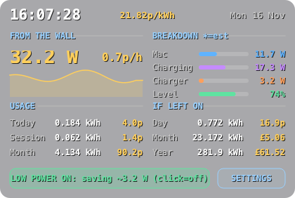

# Mac Powermon

A **transparent desktop overlay for macOS** that shows how much electricity your Mac is taking from the wall and what it costs. A port of [linux-powermon](https://github.com/kranmal/linux-powermon): same look, same single Python + Qt (PySide6) file, with the Linux `/sys` readers swapped for the power figures the Mac measures itself. No sudo needed to read them.

You enter your **unit rate** (the price per kWh on your bill), and it works out the cost per hour, today, this session, this month and a projection. One click switches **Low Power Mode** on or off and shows the watts saved.



*Rendered with `--demo` (fake data).*

## Features

| Area | Shows |
|------|-------|
| **From the wall** | watts drawn from the socket, cost per hour, 60 s graph. On battery it reads **On battery** with the Mac's own draw and the time left |
| **Breakdown** | what the Mac is using, what is going into (or coming out of) the battery, what the charger loses as heat, and the battery level |
| **Usage** | kWh and cost for today, this session and this month (saved between runs) |
| **If left on** | cost per day / month / year at the current draw |
| **Low Power Mode** | button that switches it on, shows the **watts saved**, and puts things back on the next click |
| **Settings** | change currency, unit rate and the fallback charger efficiency any time |

Interaction: **drag** with the left mouse button, **right-click** for settings, reset, opacity, float on top and quit.

**Menu bar icon:** a lightning bolt. Hover it for live watts and cost per hour; click it to hide or show the overlay, open settings, switch Low Power Mode or quit. Hiding the overlay keeps Powermon running, so usage keeps counting.

## How it works

Unlike a desktop PC, a MacBook measures its own power. Powermon reads it once a second from the `AppleSmartBattery` registry entry (`ioreg`, key `PowerTelemetryData`):

```
wall watts = adapter input + adapter loss
cost / h   = wall watts / 1000 x unit rate
usage      = wall watts x elapsed time, added up every second (kWh)
```

| Part | Source | Measured or estimated |
|------|--------|-----------------------|
| **Mac** | `SystemLoad`: everything the computer is using, screen included | **measured** |
| **Charging / From batt** | adapter input minus system load (plugged in), or the battery discharge (unplugged) | **measured** |
| **Charger** | `AdapterEfficiencyLoss`. If the Mac doesn't report a believable value it is worked out from the charger efficiency in Settings (default 88 %) and shown as `Charger*` | **measured**, else estimated |

**On battery, nothing is added to your usage.** The wall draw really is zero, and that energy is counted when the battery is recharged. So the cost per hour and the "if left on" figures shown on battery are marked `*`: they are what it will cost to put that energy back.

Usage only counts while Powermon is running, so charging that happens while it is closed (or while the Mac is asleep) is missed. Files are in `~/Library/Application Support/mac-powermon/`: `config.json` (settings and window position), `usage.json` (one number per day), `baseline.json`.

## Low Power Mode button

macOS has no CPU governor or GPU power cap to set, so the saver is the system's own **Low Power Mode**. Changing it needs root, so each click shows the normal macOS administrator password prompt and then runs `pmset`:

| Click | Runs |
|-------|------|
| ON | `pmset -a lowpowermode 1` (battery and mains) |
| OFF | puts back the battery and mains values from before, except that the power source in use is always switched off |

While it is on, the button shows how much it saves: `LOW POWER ON: saving ~3.2 W`. Powermon learns the Mac's normal draw whenever Low Power Mode is off (a running average), then shows that average minus the current draw. It compares against your *typical* draw, so it reads high if you switch it on while idle after a busy spell. Until it has about 30 seconds of data it shows `no baseline`.

The button reads its state from the system, so it stays correct if you change Low Power Mode in System Settings. The saving on an idle Mac is small; it shows under load.

## Install

Needs macOS on Apple silicon and Python 3.10+ (`uv` is used if present).

```bash
./install.sh                # creates .venv and installs PySide6 + pyobjc
./run.sh                    # start it (asks for your unit rate the first time)
./install.sh --autostart    # also start at login (launchd user agent)
./install.sh --uninstall    # remove the login item
```

```
powermon.py [--setup] [--demo]
```

| Option | Meaning |
|--------|---------|
| `--setup` | Ask for the tariff again at start |
| `--demo` | Fake data, nothing is saved (screenshots, testing) |

The first-run dialog asks for the **currency symbol** (default `£`), the **unit rate** in pence or cents per kWh (e.g. `21.82`), and the fallback **charger efficiency**. A daily standing charge is ignored because it doesn't depend on usage.

It opens in the bottom-left corner the first time, then wherever you last dragged it. It sits just above the wallpaper, on every Space, so other windows cover it; tick **Float on top** to change that.

## Known limitations

- Tested on one machine: MacBook Air M4, macOS 27, **on battery only**. The plugged-in figures (`SystemPowerIn`, `AdapterEfficiencyLoss`) are covered by unit tests with made-up readings but have not been checked against a real charger or a plug-in meter.
- **Desktop Macs** have no battery telemetry, and total power can't be read without root, so the draw is a rough model from CPU load (6 to 40 W) and everything is marked `*`.
- No CPU / GPU split. On macOS 27 the per-component energy counters don't advance for unprivileged apps, and `powermetrics` needs sudo.
- An external display with its own power supply is not included.

## Testing

```bash
.venv/bin/python tests/run_tests.py
```

Checks the power maths, the `pmset` commands, a demo render and the real sensors. It never changes a system setting and writes only to a temporary folder.

## License

[MIT](LICENSE)
